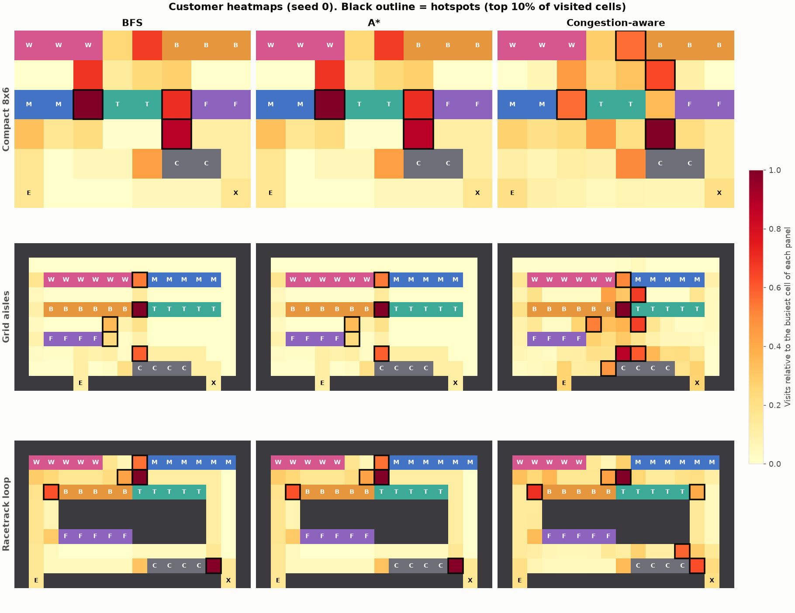
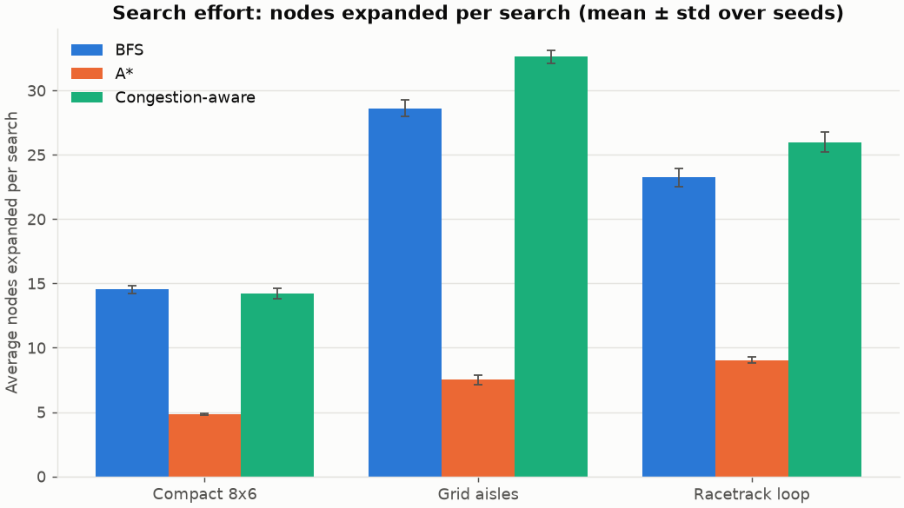
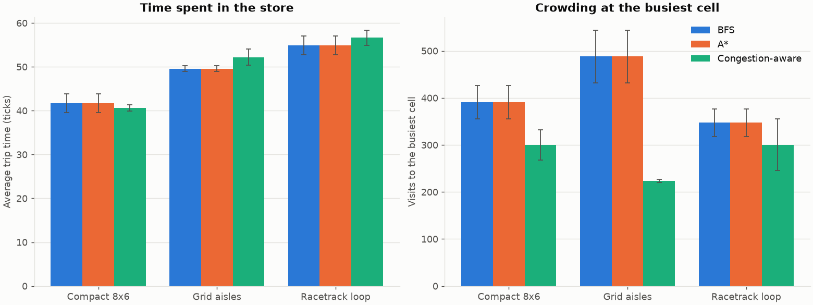

# Task A: Customer Pathfinding & Store Layout

*UrbanStyle Project: Artificial Intelligence applied to fashion retail*

> All figures below were produced from the Kaggle *Retail Sales Dataset* (1,000 transactions) and can be reproduced with `prepare_data → experiments` (see `README.md`). The raw values are in `results/metrics.json` and `results/comparison.csv`; Tables 1 to 3 are generated from those files.

## 1. Problem and Business Goal

A store layout decides where customers walk, which shelves they pass and where they queue. UrbanStyle wants to know **how customers move inside a store and which spots become crowded**, so that shelves, fitting rooms and checkout counters can be placed to keep traffic flowing and exposure to products high. A real study would need cameras or sensors. Here the store is modelled as a grid and customers as agents, which lets us compare layouts and path-planning strategies cheaply and reproducibly.

The task has four parts: a grid model of the store with product categories mapped to sections, customers who enter and walk to the sections they want, at least two search algorithms (BFS and A*), and a visualization of high-traffic areas (a heatmap). As extensions we add a third, congestion-aware planner and compare three store layouts.

## 2. Store Model and Layouts

The floor plan is an ASCII map in `config.LAYOUTS`, parsed into a grid of (row, col) cells (`store/layout.py`). Customers move in the four compass directions at one cell per tick.

| Symbol | Meaning |
|---|---|
| `#` | wall (blocked) |
| `.` | floor (walkable) |
| `E`, `X` | entrance and exit (walkable floor) |
| `C` | checkout counter (blocked like a shelf) |
| `W` `M` `B` `T` `F` | shelves: Women's Wear, Men's Wear, Beauty & Cosmetics, Accessories & Tech, Fitting Rooms (blocked) |

A shelf is visited from the floor cells that touch it, called its *access cells*. A layout is rejected on load unless it has exactly one entrance and one exit and the exit and every section can be reached from the entrance. Three layouts were designed.

**Compact 8x6** is the 8 × 6 example from the brief: one open room with shelves in three rows and the checkout beside the exit.

```
WWW..BBB
........
MM.TT.FF
........
.....CC.
E......X
```

**Grid aisles** (16 × 10) has parallel shelf rows with straight corridors between them. The corridors are joined by the side aisles and by a gap in the middle of the shelf rows. Entrance and exit are doors in the bottom wall.

```
################
#..............#
#.WWWWWW.MMMMM.#
#..............#
#.BBBBBB.TTTTT.#
#..............#
#.FFFF.........#
#..............#
#.......CCCC...#
####E########X##
```

**Racetrack loop** (16 × 10) has a central island of shelves surrounded by a loop corridor, with the clothing sections along the top wall.

```
################
#WWWWW...MMMMMM#
#..............#
#..BBBBBTTTTT..#
#..##########..#
#..##########..#
#..FFFFF#####..#
#..............#
#........CCCC..#
#E############X#
```

## 3. From Sales Data to Store Sections

The dataset has no spatial information, but each transaction says *who* bought *what*. We use it to decide which sections customers want to visit. Categories map to sections as follows: Clothing goes to Women's Wear (female customers) or Men's Wear (male customers), Beauty to Beauty & Cosmetics, and Electronics to Accessories & Tech. Fitting Rooms and Checkout are not categories: customers use them as part of the shopping process.

`python -m data.prepare_data` summarises the 1,000 transactions into `results/demand_profile.json`:

- **Category share:** Clothing 35.1%, Electronics 34.2%, Beauty 30.7%. The three categories are almost equally popular.
- **Gender split:** Clothing buyers are 49.6% female and 50.4% male, so clothing demand splits almost evenly between Women's and Men's Wear. Each of the two sections receives only about half of it (roughly 17.5% of transactions each), while Beauty (30.7%) and Accessories & Tech (34.2%) are each served by a single section and draw about twice as many customers per section. Beauty buyers are 54.1% female.
- **Quantity:** items per transaction are almost uniform on 1 to 4 (25.3%, 24.3%, 24.1% and 26.3% for quantities 1 to 4).

Each simulated customer is a random real transaction (gender, age, category, quantity). The shopping list is:

1. the section of the purchased category;
2. `min(quantity − 1, 2)` extra browsing stops, drawn from the category mix of the store and never the same section twice in a row (about 1.25 extra stops per customer on average);
3. after any clothing section, a visit to the Fitting Rooms with probability 0.3;
4. then the Checkout, then the Exit.

Quantity therefore turns directly into longer routes: customers who buy four items browse more of the store.

## 4. Search Algorithms

All planners share one signature, `fn(layout, start, goals, heat) -> SearchResult(path, nodes_expanded, cost)`, where `goals` is a single cell or a set of cells. A section has several access cells, so the search stops at whichever goal it reaches first. This finds the nearest access cell by *walking* distance, not by straight-line distance, which matters when a shelf blocks the direct route. Moves cost 1 each and a goal that cannot be reached returns `path = None`. The *nodes expanded* counter is our measure of search effort.

### 4.1 Breadth-first search (BFS)

BFS keeps a FIFO queue and expands cells in order of their distance from the start. The first goal taken from the queue is therefore a nearest one, and the path has the fewest steps. It is simple and optimal with unit costs, but it explores a disc of cells around the start in all directions, including those pointing away from the goal.

### 4.2 A*

A* keeps a priority queue ordered by f = g + h, where g is the number of steps taken so far and h estimates the steps left. We use the Manhattan distance to the nearest goal, h(n) = min over goals of |Δrow| + |Δcol|. Ties on f are broken by lower h, then by insertion order, so results are deterministic.

*Why the path is optimal (proof sketch).* On a 4-connected grid with unit costs every step changes the row or the column by exactly one, so reaching a goal g from n needs at least |Δrow| + |Δcol| steps: h never overestimates, which makes it **admissible**. For a neighbour n′ of n the triangle inequality gives d(n, g) ≤ 1 + d(n′, g), hence h(n) ≤ 1 + h(n′) = c(n, n′) + h(n′): h is **consistent**. The same holds for the minimum over several goals, because h(n) = min_g d(n, g) ≤ min_g (1 + d(n′, g)) = 1 + h(n′). With a consistent heuristic f never decreases along a path, so each cell is expanded once with its optimal g, and the first goal removed from the queue is reached by a shortest path. A* therefore returns paths exactly as long as BFS's. It also never expands more cells than BFS: let C* be the optimal length. A* expands only cells with f ≤ C*. Cells with f < C* have g < C*, and BFS expands all of those too; the only cells with f = C* and g = C* are goals. The tests check both claims on all layouts (equal path lengths, A* ≤ BFS in nodes expanded, also with several goals).

### 4.3 Congestion-aware Dijkstra

The third planner minimises a cost that includes crowds: entering a cell costs 1 + α · t̂, where t̂ ∈ [0, 1] is the recent traffic of that cell divided by the traffic of the busiest cell, and α = 3. It is Dijkstra's algorithm (a priority queue on the accumulated cost), so it is optimal for that cost, and with no traffic it behaves exactly like BFS. Crowded cells are expensive, so customers take a longer but emptier route when one exists. The Manhattan heuristic is not used, so it expands about as many cells as BFS or more (Section 6).

The traffic signal is a decaying occupancy, traffic ← 0.9 · traffic + (customers on the cell this tick), not the cumulative heatmap. The cumulative count is dominated by the cells where people stand still (the access cells, which are also the goals) and never forgets. Decaying traffic describes the crowd of roughly the last ten ticks, which is what a customer entering a corridor would actually see.

## 5. Simulation Design

`StoreSimulation(layout, algorithm, n_customers, seed)` advances in ticks (`simulation/store_sim.py`; it has no graphics, so it is easy to test):

1. every customer in the store either dwells at its stop or moves one cell along its planned path;
2. every 4 ticks a new customer appears on the entrance cell, until all have entered;
3. the heat and traffic grids are updated.

On arriving at the access cell of a section the customer dwells for a random 3 to 10 ticks, then plans the path to the next stop with the chosen algorithm. Arriving at the exit ends the trip. One seeded random generator drives the whole run, so a seed reproduces everything, and for the same seed all three algorithms serve exactly the same customers. Customers do not block one another, so congestion shows up only in the heat and traffic grids.

**Heat semantics.** At the end of every tick, `heat[row, col]` is increased by one for each customer standing on that cell. This includes the tick of entering, the tick of arriving at the exit and every tick spent dwelling. So `heat.sum()` equals the total number of customer-ticks spent in the store, and a heat value counts customer-ticks, not distinct customers. **Hotspots** are the walkable cells whose heat is at or above the 90th percentile of the visited (non-zero) cells.

## 6. Results

Setup: 60 customers per run, seeds 0, 1 and 2, every layout × algorithm combination (27 runs). Values are mean ± sample standard deviation over the seeds. Search effort is the average number of nodes expanded per planned leg (about 270 legs per run).

**Table 1.** Search effort and path length.

| Layout | Algorithm | Avg nodes / search | Total nodes | Avg path length (steps) |
|---|---|---:|---:|---:|
| Compact 8x6 | BFS | 14.5 ± 0.3 | 3,984 ± 128 | 3.71 ± 0.09 |
| Compact 8x6 | A* | 4.8 ± 0.0 | 1,325 ± 44 | 3.71 ± 0.09 |
| Compact 8x6 | Congestion-aware | 14.2 ± 0.4 | 3,788 ± 158 | 3.88 ± 0.04 |
| Grid aisles | BFS | 28.6 ± 0.6 | 7,795 ± 193 | 5.60 ± 0.16 |
| Grid aisles | A* | 7.5 ± 0.4 | 2,047 ± 98 | 5.60 ± 0.16 |
| Grid aisles | Congestion-aware | 32.6 ± 0.5 | 8,912 ± 310 | 5.96 ± 0.06 |
| Racetrack loop | BFS | 23.2 ± 0.7 | 6,023 ± 186 | 7.30 ± 0.24 |
| Racetrack loop | A* | 9.0 ± 0.2 | 2,344 ± 99 | 7.30 ± 0.24 |
| Racetrack loop | Congestion-aware | 26.0 ± 0.7 | 6,768 ± 256 | 7.69 ± 0.20 |

**Table 2.** Customer and crowding metrics. *Ticks to empty* is the time until the last customer leaves, *peak heat* is the largest cell count, *mean heat* is the average over floor cells and *hotspot share* is the percentage of floor cells that are hotspots.

| Layout | Algorithm | Avg trip (ticks) | Ticks to empty | Peak heat | Mean heat | Hotspot share (%) |
|---|---|---:|---:|---:|---:|---:|
| Compact 8x6 | BFS | 41.7 ± 2.1 | 283 ± 5 | 391 ± 35 | 73.5 ± 3.7 | 8.8 ± 0.0 |
| Compact 8x6 | A* | 41.7 ± 2.1 | 283 ± 5 | 391 ± 35 | 73.5 ± 3.7 | 8.8 ± 0.0 |
| Compact 8x6 | Congestion-aware | 40.6 ± 0.7 | 294 ± 5 | 300 ± 32 | 71.7 ± 1.3 | 11.8 ± 0.0 |
| Grid aisles | BFS | 49.6 ± 0.6 | 287 ± 11 | 488 ± 56 | 35.4 ± 0.5 | 6.0 ± 0.0 |
| Grid aisles | A* | 49.6 ± 0.6 | 287 ± 11 | 488 ± 56 | 35.4 ± 0.5 | 6.0 ± 0.0 |
| Grid aisles | Congestion-aware | 52.2 ± 1.9 | 291 ± 4 | 223 ± 4 | 37.3 ± 1.3 | 9.5 ± 0.0 |
| Racetrack loop | BFS | 54.9 ± 2.1 | 293 ± 3 | 347 ± 29 | 55.8 ± 2.2 | 8.5 ± 0.0 |
| Racetrack loop | A* | 54.9 ± 2.1 | 293 ± 3 | 347 ± 29 | 55.8 ± 2.2 | 8.5 ± 0.0 |
| Racetrack loop | Congestion-aware | 56.6 ± 1.7 | 296 ± 9 | 300 ± 55 | 57.6 ± 1.8 | 10.2 ± 0.0 |

**Table 3.** Top-5 hotspots of seed 0 (A\*), with the section(s) that touch the cell.

| Layout | Rank | Cell (row, col) | Heat | Context |
|---|---:|---|---:|---|
| Compact 8x6 | 1 | (2, 2) | 358 | Accessories & Tech / Men's Wear |
| Compact 8x6 | 2 | (3, 5) | 316 | Checkout |
| Compact 8x6 | 3 | (2, 5) | 251 | Accessories & Tech / Fitting Rooms |
| Compact 8x6 | 4 | (1, 2) | 245 | Women's Wear |
| Compact 8x6 | 5 | (0, 4) | 239 | Beauty & Cosmetics |
| Grid aisles | 1 | (4, 8) | 548 | Accessories & Tech / Beauty & Cosmetics |
| Grid aisles | 2 | (7, 8) | 325 | Checkout |
| Grid aisles | 3 | (2, 8) | 293 | Men's Wear / Women's Wear |
| Grid aisles | 4 | (5, 6) | 189 | Beauty & Cosmetics |
| Grid aisles | 5 | (6, 6) | 127 | Fitting Rooms |
| Racetrack loop | 1 | (2, 8) | 381 | Accessories & Tech |
| Racetrack loop | 2 | (8, 13) | 376 | Checkout |
| Racetrack loop | 3 | (3, 2) | 236 | Beauty & Cosmetics |
| Racetrack loop | 4 | (1, 8) | 212 | Men's Wear |
| Racetrack loop | 5 | (2, 7) | 162 | Beauty & Cosmetics |

Figures (in `results/figures/`):

- `heatmaps.png`: heatmaps of every layout × algorithm for seed 0, hotspots outlined.
- `nodes_expanded.png`: nodes expanded per search.
- `layout_comparison.png`: average trip time and peak heat per layout.
- `app.png`: a screenshot of the Pygame app.







### 6.1 Algorithms

- **BFS and A* find equally long routes**, so every customer metric (path length, trip time, peak heat) is identical for the two. The difference is the search effort: A* expands 67%, 74% and 61% fewer nodes than BFS in Compact, Grid aisles and Racetrack (4.8 vs 14.5, 7.5 vs 28.6 and 9.0 vs 23.2 nodes per search). The gain grows with the size of the store, since BFS explores more of the floor while A* heads for the goal.
- **Congestion-aware planning trades distance for crowding.** Compared with A*, peak heat falls by 23%, 54% and 14% (Compact, Grid aisles, Racetrack) and the average leg becomes 4.6%, 6.6% and 5.4% longer. Customers do not queue in the simulation, so the only systematic effect on trip time is the detour itself: trip time changes by −2.6%, +5.3% and +3.1%, small next to the spread over seeds in Compact and Racetrack. The store empties at about the same time (+3.8%, +1.4%, +0.9%). The price is search effort: it expands about 2.9, 4.3 and 2.9 times as many nodes as A*, since it has no heuristic. These numbers hold for 60 customers entering one every 4 ticks; other loads would change them.

### 6.2 Layouts

Trip time grows with the size of the store and the length of the routes: 41.7, 49.6 and 54.9 ticks for Compact 8x6, Grid aisles and Racetrack loop with A\*. The loop forces customers around the island, so a trip there is the longest and passes the most shelves. The compact room is the quickest to shop in, but it packs 60 customers into 34 floor cells and has the highest *mean* heat. Peak heat with A\* is 391, 488 and 347 for Compact, Grid aisles and Racetrack. It is highest in Grid aisles, where the gap between the Beauty and Tech shelves is also the link between the corridors above and below. The racetrack spreads visits over its corridors and has the lowest peak.

## 7. Hotspot Interpretation and Recommendations

The hotspots are not random. They fall in three places (Table 3 and `heatmaps.png`):

1. **Checkout access cells.** In every layout one of the two busiest cells is the floor cell next to the counters: (3, 5) in Compact, (7, 8) in Grid aisles and (8, 13) in Racetrack. Every customer passes through it once and stays for the dwell time.
2. **Cells between two sections.** The busiest cell in Compact and in Grid aisles touches two sections at once (for example Accessories & Tech and Men's Wear in Compact). One floor cell serves the shelves on both sides, so customers of both sections stand on it. In the Racetrack the busiest cell is the top of the island, next to Accessories & Tech.
3. **Cells next to the high-demand sections.** Accessories & Tech and Beauty are bought by about a third of the customers each, but each is a single section, so their access cells dominate the hotspot lists, ahead of the clothing sections that split their demand between Women's and Men's Wear.

Recommendations for UrbanStyle, assuming that the simulated behaviour is realistic:

- **Add checkout capacity and room around the counters.** Add a second queue lane or counters that can be reached from both sides, and keep the cells in front of them free of displays. The checkout cell is a hotspot in all three layouts and is where queues will form.
- **Widen pinch points.** Where one floor cell is shared by two sections, make the gap between the shelves two cells wide (or shift one shelf) so that customers of different sections do not crowd one spot.
- **Split the high-demand categories.** Beauty and Accessories & Tech draw the most single-section traffic. Provide a second display or access side for them, or place them at opposite ends of the store, so that their access cells do not coincide with a crossing.
- **Use a loop for exposure and an open room for speed.** The loop has the longest trips and the lowest peak, which means more shelves passed per customer and less crowding. Put the checkout near the exit at the end of the loop so that customers cross the whole store first. A compact open room suits small stores and quick shopping, but needs more floor area per customer in peak hours.
- **Guide customers away from crowds.** The congestion-aware planner models staff or signage that directs customers to quieter aisles. It cut the crowding of the busiest cell by 14% to 54% while adding only a fraction of a step to each leg. Real shoppers do not follow guidance as obediently as a planner does, so this is an upper bound.

## 8. Limitations

1. **Behavioural assumptions.** The dataset has no information about layout or movement. Dwell times (3 to 10 ticks), the fitting-room probability (0.3), the arrival rate (one customer per 4 ticks) and the rule that extra stops follow the category mix are modelling choices, not measurements. The results are therefore comparative (which layout or algorithm is better) rather than absolute predictions.
2. **No interaction between customers.** Customers walk through each other and never wait for a free cell or a free checkout. Real queues would add delays, so the crowding we report is the *demand* for each cell, not the effect of a blocked cell. Real congestion-aware guidance would also have to change what customers actually do.
3. **Nearest access cell.** Customers go to the access cell that is cheapest to reach, so the cells close to their previous stop are used more than other access cells of the same section, and the hotspots over-represent them.
4. **Heat counts customer-ticks.** A cell where customers wait is hot even if few people pass through it. This is the right measure of crowding but not of footfall.
5. **Hotspot share** is the fraction of cells above the 90th percentile of the visited cells, so it is close to 10% by construction and does not discriminate between layouts. Its standard deviation over seeds is zero because the same number of cells is visited in every seed.
6. **Few seeds and customers.** Three seeds of 60 customers give standard deviations that are small next to the algorithm effects on nodes expanded and peak heat, but comparable to some of the differences in trip time.
7. **Three hand-built layouts.** They are not optimised. A natural extension is to search over shelf arrangements automatically, using the peak heat or the trip time as the objective.
